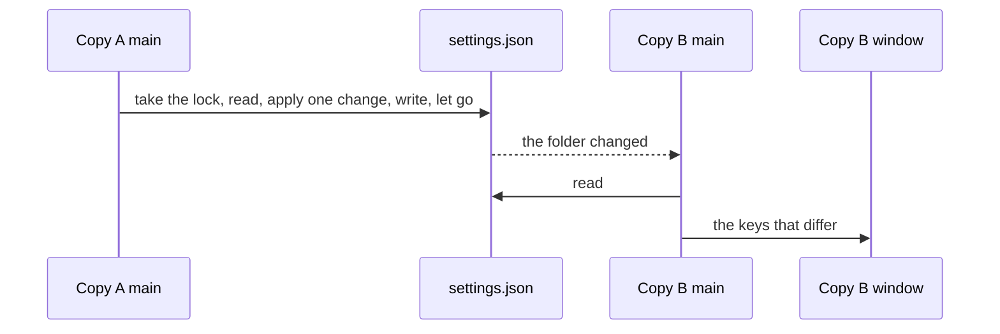

# Proposal: settings that every copy shares

Status: draft, 2026-11-13. No Linear issues yet; the work is listed under [Order](#order).

## In one line

Settings, key bindings and what the app remembers move out of the window's `localStorage` into small JSON files in the
app's data folder. Main owns them: it reads them before the window opens, writes one change at a time under a lock, and
tells every window when another copy changed them. The logic lives in a new package, `@parity-app/settings`, that takes
text and returns data, so it's tested without Electron.

## Why now

Many copies of Parity run at once, installed and `pnpm dev`, and all of them use one data folder
(`%APPDATA%\@parity\desktop`, or `PARITY_USER_DATA` when it's set). Chromium lets only one process at a time use that
folder's Local Storage and Session Storage.

- **The theme resets to dark.** A copy that doesn't hold the storage reads no preferences, so its window sends main the
  default theme, dark, and main writes it over `theme.json`. Every copy opens dark next time.
- **A later copy freezes for about 3 seconds.** tldraw reads `sessionStorage` as it loads. In a copy that doesn't hold
  the storage, that read blocks until Chromium gives up, and the window draws nothing until then.
- **Changes made in a copy that doesn't hold the storage are lost** when it closes: settings, layout, recent projects
  and stars.

Random sign-outs had a different cause, a failed read of the `account` file deleting it, and are fixed separately (PR
#600).

## What's stored today

| Where                                                                       | What                                                                                                     | After this                                     |
| --------------------------------------------------------------------------- | -------------------------------------------------------------------------------------------------------- | ---------------------------------------------- |
| `localStorage` `parity.preferences`                                         | Theme, snapping, export scale and sizes, Components view, grid, autosave, performance stats, code editor | `settings.json`                                |
| `theme.json` (main)                                                         | The theme again, so the window opens in it                                                               | `settings.json`; no longer read or written     |
| `localStorage` `parity.layout`                                              | Panel sizes, which panels and tabs show                                                                  | `state.json`                                   |
| `localStorage` `parity.workspace`                                           | The open tabs, to reopen next time                                                                       | `state.json`                                   |
| `localStorage` `parity.recent`                                              | Recent projects                                                                                          | `projects.json`                                |
| `localStorage` `parity.projects`                                            | When each project last opened, and stars                                                                 | `projects.json`                                |
| `localStorage` `parity.recentSearches`                                      | Recent picks in Search actions                                                                           | `state.json`                                   |
| tldraw's own `localStorage`                                                 | tldraw's user preferences (color scheme, snap mode)                                                      | Set from `settings.json` before tldraw draws   |
| `keymap.ts`                                                                 | Every shortcut, fixed in code                                                                            | The defaults; changes go in `keybindings.json` |
| `open-projects.json` (project service)                                      | Projects to open at once when the service starts; the CLI reads it too                                   | Stays: a head start the window's tabs correct  |
| `telemetry.json`, `updates.json`                                            | Diagnostics level and install ID; Get beta updates                                                       | `settings.json`; no longer read or written     |
| `account`                                                                   | The signed-in account, encrypted                                                                         | Stays as it is                                 |
| `recent-searches.json`, `connector-placements.json`, `installed-build.json` | Main's own lists and counts                                                                              | Stay as they are                               |
| `logs/`, `hangs/`, `recovery/`, `pictures/`, `bitmaps/`                     | Logs, recovery copies and caches                                                                         | Stay as they are                               |

## The files

Four files in the data folder, each for one kind of thing, so a person can read, back up or delete one without the
others.

- **`settings.json`: choices the person made,** in Settings or the menus. Only what was changed is written: a key that's
  absent means its default. A new copy writes nothing until the person changes something, apart from the install ID it
  makes on its first run.
- **`keybindings.json`: shortcuts the person changed,** as a list of `{ command, keys }`. An entry's `keys` replace all
  of that command's keys, and `keys: []` removes them. The keymap in code stays the defaults and the one place each
  command is named.
- **`state.json`: what the app remembers for itself,** with no setting behind it: layout, open tabs, recent searches.
  Layout is shared: each copy writes it as it changes, and a copy reads it when it starts.
- **`projects.json`: recent and starred projects,** keyed by folder as today. It's apart from `state.json` because the
  start page lists it and every copy adds to it.

Secrets never go in these files. Today only the account is a secret, encrypted by main with safeStorage; extension
secrets join it (below).

## What other copies see

| File               | Other running copies                                                                |
| ------------------ | ----------------------------------------------------------------------------------- |
| `settings.json`    | Apply it at once: set light in one copy, and the others turn light                  |
| `keybindings.json` | Apply it at once                                                                    |
| `projects.json`    | Apply it at once, on the start page                                                 |
| `state.json`       | Don't apply it. Each copy keeps the layout and tabs it has, and reads them at start |

## Extension settings

Extensions (adapters, connectors and the rest) declare their settings in their manifest, as JSON Schema with a `scope`
each, as [developer-api.md](developer-api.md#settings) sets out. That proposal is on the `spike/read-only-viewer` branch
for now. This package keeps the part that belongs to the person:

- **`app` scope** (per person, every project) goes in `settings.json` under `extensions.<extension id>`, keyed by the
  setting key, such as `storybook.configDir`. The extension's schema checks each value; one that fails reads as its
  default, and the extension's page says so. An extension can name a key it renamed, and the old value moves across the
  first time it's read.
- **An extension's private values** (`parity.state.app`, not settings) go in `state.json` under the same id.
- **`project` scope** isn't this package's. It goes in the project's `.par`, in its `extensions` field, and is saved
  with the file like any other change. The window owns it and sends it to the project service.
- **`secret` scope** goes only through main, encrypted with safeStorage. The files hold only whether a secret is set.
- **Nothing is per machine or per team.** Teams use project settings.

Extensions run in a Node host per extension per open project, started by the project service. Main sends the service
`app` values over its channel, and each change to them, and the service passes them on. Neither main nor the window runs
extension code.

## How it works

### The package

`@parity-app/settings` has the schemas and functions that take data and return data:

- `read(text)` gives each value, the default for each that's missing or doesn't read, and a list of problems with their
  line numbers. One bad value never resets the rest, as `readPreferences` does today.
- `apply(text, change)` gives the file's new text after one change (set a key, reset a key, add a recent project). It
  refuses text that doesn't parse rather than starting again from nothing.
- `bindings(keymap, overrides, platform)` gives the keys for each command and any keys two commands share.
- `differ(before, after)` gives the keys that changed, which is what main sends windows.

### Main's store

- **Startup.** Main reads the files synchronously before the window opens; they're a few kilobytes. A missing file
  (`ENOENT`) means defaults. A file another process holds (`EBUSY`, `EPERM`, `EACCES`) is tried again a few times, as
  `writeWhole` does; if it's still held, this run uses defaults, holds back its changes as for a failed write, and reads
  again on the next event. Only text that doesn't parse marks the file **unreadable** (below), and a later read that
  parses clears the mark.
- **The install ID** is made on the first run, when `settings.json` has none, and written under the lock, so two copies
  starting together end up with one ID.
- **One change.** Changes in a copy are queued and made one at a time. For each, main takes the file's lock, reads the
  file, applies the change, writes it whole with `writeWhole` from `json-file.ts`, and lets go. The lock is
  `<file>.lock`, made with an exclusive create and holding the process ID and the time. A copy waits for it with growing
  gaps, for up to 2 seconds, then treats the change as a failed write. A lock older than 10 seconds was left by a copy
  that died: it's taken over by renaming it to a name of the copy's own, which only one copy can do, and then creating a
  new one. So two copies changing settings at the same moment both keep their change.
- **When a write fails** (the folder can't be written, the disk is full, or antivirus holds the file past `writeWhole`'s
  retries), the change still applies for this run and waits in a queue of unsaved changes. Each retry, with growing
  gaps, takes the lock and applies the queue to the file as it is then, so it never undoes other copies' changes. Every
  read has the queue applied on top before main compares it, so a setting doesn't flip back meanwhile. The window shows
  one notice, "Couldn't save your settings", until a write succeeds. Its request never fails because of it.
- **An unreadable file** keeps the last good values (or the defaults at startup). Settings shows one line naming the
  file and the line, with Open file and Start again. Start again renames the file to `<file>.unreadable-<time>` and
  starts a new one. Main never replaces a file it couldn't read without that.
- **Watching.** Main watches the data folder, not the files, because a rename over a file ends a watch on it on Linux.
  It reacts only to the four file names (not `.tmp` or `.lock`), waits 150 ms after the last event, and reads again. It
  also checks each file's size and modified time when a window gains focus, since events can be lost, coalesced, or
  never arrive on a network folder, and it restarts the watch if it errors. It sends windows only the keys that differ
  from what it last had, so its own writes cost nothing.

### The window

- **Before the first frame,** the preload asks main for the settings and layout synchronously. Main answers from memory,
  never from the disk, so the call takes no longer than a message. A reload asks again. The first frame then has the
  right theme and panels, and tldraw starts in the right color scheme.
- **Changes go to main over IPC,** which checks each against the schema, and come back to every window as changes.
  `setting.changed` is still recorded, from the window, as now.

## Security

The project's own code runs in the editor window's page beside `window.canvasHost` (see `shared/ipc-checks.ts`), so
anything the window can ask main to change, a project can too. A schema check doesn't stop a valid but hostile value.

You decided on 2026-11-14 to accept that: the window can change every setting, including extension settings and secrets,
with main checking each value against its schema. A project's code could, for example, point an extension at its own
server. What limits it:

- An extension that's given a secret only gets its own, as developer-api.md says.
- Key bindings get a way to change them from the window only with the screen for them; until then they're edited by
  hand.

## Open tabs across copies

Each copy keeps its tabs in `state.json` under its own entry, with a random ID, and updates it as tabs change and every
10 seconds while it runs, so a crash or an update restart loses nothing. An entry not updated for 30 seconds belongs to
a copy that's gone. At start, a copy takes the newest such entry under the file's lock, by writing its own ID into it,
so two copies starting together don't both take it. Entries older than a week are removed. A copy started for one
project, as `pnpm dev <folder>` does, opens that project, doesn't take an entry, and doesn't write one.

The project service's `open-projects.json` stays a head start and stays the last writer's list. With several copies it
can start a project another copy had; the window's tabs decide what stays open, and the service closes the rest after a
minute, as it does now.

## The freeze, once settings have moved

Once nothing Parity needs is in Chromium's storage, the editor window can use an in-memory session (a partition without
`persist:`), so no copy waits for another's storage. The account isn't affected: safeStorage's key is in the data
folder's `Local State`, which a partition doesn't move. An earlier try moved the whole session folder instead, which did
break decryption.

Before turning it on, check that nothing still loads in the default session (Sentry's replay, sign-in pages, tldraw if
it ever gets a `persistenceKey`), and that the account still decrypts with two copies running on Windows, and on Linux
with each keyring.

## Key bindings

- Keys are written as on Windows, as `keymap.ts` writes them, and Ctrl is Cmd on a Mac. Control on a Mac and chords (two
  shortcuts in a row) aren't supported.
- When two commands end up with the same keys, the one the person set wins, and Settings lists the clash. An entry for a
  command that doesn't exist, or keys that don't read, is skipped and listed, and kept in the file.
- On a Mac, the native Edit menu's Cut, Copy, Paste and Select all keep Cmd X, C, V and A whatever the file says.
- tldraw's own shortcuts are off, and the code editor's apply only while it has focus, so neither clashes.
- A screen for changing shortcuts is separate work; until then the file is edited by hand.

## Problems people and we can see

- **People:** the one notice when settings can't be saved, and the line in Settings for an unreadable file, a bad value
  or a skipped key binding. Nothing opens a dialog.
- **Us:** each problem is logged through main's logger, and sent to Sentry once per file and problem, with the file's
  values left out.

## Tests

- **The package:** `read` with missing and bad values; `apply` keeping keys it doesn't change and refusing text that
  doesn't parse; `bindings` with replaced, removed and clashing keys.
- **Main's store**, on a temp folder with two stores: both copies' changes survive changes at the same moment; a stale
  lock is taken by only one; one store sees the other's change; a held file isn't marked unreadable; an unreadable file
  is never written over; a failed write keeps the change and doesn't undo the other store's when it lands.
- **The window:** the first frame has the saved theme; a change from main updates the menus.
- **End to end, in CI:** a theme set in one copy reaches a second and survives both closing. Each feature's section in
  [editor.md](../editor.md) names its tests.

## Telemetry and updates

- **The diagnostics level, Get beta updates and the install ID** move into `settings.json` as `telemetry`, `betaUpdates`
  and `installId`, and `telemetry.json` and `updates.json` are no longer read or written.
- **`PARITY_TELEMETRY` and `DO_NOT_TRACK`** still win over the setting, through `resolveTelemetry`, and Settings still
  says when they do.
- **The CLI** reads `settings.json` instead, finding it with `desktopDataFolder`. It never writes it.

## What people notice

- Settings, layout, recent projects and stars stay the same in every copy, and the theme stops resetting.
- A second copy no longer freezes at start.
- The first build with these files starts from defaults: theme, preferences, layout, recent projects, stars and the
  install ID. Nothing is carried over from the old storage or files.

## Order

Each step ships alone.

1. **The package**, with the schemas for today's preferences, layout, tabs and projects. _Done when_ its tests pass.
2. **Main's store and the preload**, with `settings.json` replacing `parity.preferences`. _Done when_ the store's tests
   pass with two stores on one folder, and in CI a theme set in one copy reaches a second and both reopen in it.
3. **`projects.json` and `state.json`**, replacing the rest of `localStorage`. _Done when_ a project starred in a second
   copy is still starred after both close, and a crashed copy's tabs reopen.
4. **The in-memory session**, after the checks above. _Done when_ a second copy's startup trace has no wait on
   `sessionStorage` (about 3 s now), and the account still decrypts with two copies running.
5. **`keybindings.json`**, read by the keymap. _Done when_ a key changed in the file works in every copy and the menus
   show it.
6. **Telemetry and updates folded in**, with the CLI reading the new files. _Done when_ Settings' diagnostics level and
   Get beta updates are in `settings.json`, and the CLI reports the same level as the app.
7. **Extension settings in `app` scope**, once extensions load from their manifests.

## Calls to make

These are yours; each will be marked with the date once decided.

- **Start from defaults, carrying nothing over** (your call, 2026-11-14). There's no backward compatibility with the old
  storage, the old files or older builds.
- **The install ID, diagnostics level and Get beta updates go in `settings.json`** (your call, 2026-11-14), as in
  [Telemetry and updates](#telemetry-and-updates).
- **The window can change every setting** (your call, 2026-11-14), as in [Security](#security).
